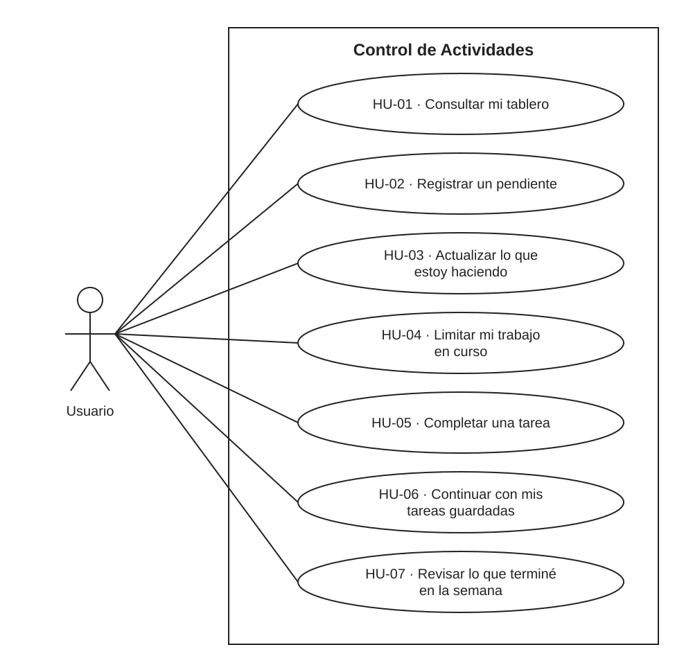

# Historias de usuario — Control de Actividades

Estas historias describen el uso del MVP desde la perspectiva del [Usuario](../01-Usuarios/Rol%20-%20Usuario.md), una sola persona que organiza sus pendientes personales. Se basan en los [requisitos funcionales](../02-Requisitos/Requisitos-Funcionales.md) y respetan el [alcance del MVP](../03-Alcance/Alcance-MVP.md).

Los criterios de aceptación definen comportamientos por implementar y verificar. Su inclusión no significa que las historias estén desarrolladas o aprobadas.

## Diagrama de casos de uso

### Explicación del diagrama

El **Usuario** es el único actor y se representa fuera del sistema. El rectángulo delimita **Control de Actividades**. Cada óvalo identifica uno de los siete casos de uso con el código de su historia, y cada línea representa la asociación del Usuario con ese caso.

El usuario consulta su tablero, registra pendientes, actualiza lo que está haciendo, mantiene su trabajo en curso dentro del límite de 10 tareas y completa las tareas terminadas. También puede continuar con sus datos guardados y revisar cuántas tareas completó en la semana.

Las explicaciones y los criterios de aceptación de cada historia se encuentran en los apartados siguientes y en sus documentos enlazados. El diagrama describe el alcance previsto; su inclusión no acredita funcionalidades implementadas ni pruebas realizadas.

## Resumen

| Historia | Necesidad | Requisito relacionado |
| --- | --- | --- |
| [HU-01](HU-01.%20Consultar%20mi%20tablero.md) | Ver mis pendientes en un solo lugar. | RF-01 |
| [HU-02](HU-02.%20Registrar%20un%20pendiente.md) | Registrar una nueva tarea. | RF-02 |
| [HU-03](HU-03.%20Actualizar%20lo%20que%20estoy%20haciendo.md) | Actualizar el estado de una tarea sin completarla. | RF-03 |
| [HU-04](HU-04.%20Limitar%20mi%20trabajo%20en%20curso.md) | Mantener acotado mi trabajo en curso. | RF-04 |
| [HU-05](HU-05.%20Completar%20una%20tarea.md) | Marcar una tarea como completada. | RF-03 y RF-06 |
| [HU-06](HU-06.%20Continuar%20con%20mis%20tareas%20guardadas.md) | Recuperar mis tareas y cambios guardados. | RF-05 |
| [HU-07](HU-07.%20Revisar%20lo%20que%20termin%C3%A9%20en%20la%20semana.md) | Reconocer mi avance semanal. | RF-06 |

## HU-01. Consultar mi tablero

La explicación y los criterios detallados están en [HU-01. Consultar mi tablero](HU-01.%20Consultar%20mi%20tablero.md).

**Como usuario, quiero ver mis tareas organizadas por estado al abrir la aplicación, para conocer mis pendientes sin buscar en notas o mensajes separados.**

**Criterios de aceptación:**

- Dado que abro la aplicación, cuando termina la carga, entonces accedo directamente al tablero sin iniciar sesión ni introducir credenciales.
- Dado que hay tareas guardadas, cuando consulto el tablero, entonces veo sus títulos en **Pendiente**, **En curso** o **Completadas**, según su estado; cada tarea aparece en una sola columna.
- Dado que todavía no tengo tareas, cuando abro el tablero, entonces veo las tres columnas vacías y puedo crear la primera tarea.
- Dado que falla la carga de los datos, cuando se muestra el resultado, entonces recibo un mensaje de error y no se presenta el fallo como un tablero vacío.

## HU-02. Registrar un pendiente

La explicación y los criterios detallados están en [HU-02. Registrar un pendiente](HU-02.%20Registrar%20un%20pendiente.md).

**Como usuario, quiero crear una tarea con un título, para registrar lo que necesito hacer antes de olvidarlo.**

**Criterios de aceptación:**

- Dado que introduzco un título no vacío, cuando guardo correctamente, entonces la tarea aparece en **Pendiente**.
- Dado que el título está vacío o contiene solo espacios, cuando intento guardarlo, entonces el sistema rechaza la creación y explica qué debo corregir.
- Dado que ya hay 10 tareas en **En curso**, cuando creo un nuevo pendiente, entonces puedo guardarlo en **Pendiente** sin superar la capacidad de **En curso**.
- Dado que falla el guardado, cuando se comunica el error, entonces no se informa que la tarea se registró y el título permanece en el formulario mientras la página siga abierta.

## HU-03. Actualizar lo que estoy haciendo

La explicación y los criterios detallados están en [HU-03. Actualizar lo que estoy haciendo](HU-03.%20Actualizar%20lo%20que%20estoy%20haciendo.md).

**Como usuario, quiero mover una tarea entre Pendiente y En curso, para que el tablero refleje lo que estoy atendiendo y lo que todavía debe esperar.**

**Criterios de aceptación:**

- Dado que una tarea está en **Pendiente** y hay capacidad disponible, cuando la muevo a **En curso**, entonces deja de aparecer en la columna de origen y aparece en la de destino.
- Dado que una tarea está en **En curso**, cuando la devuelvo a **Pendiente**, entonces el movimiento se guarda y queda una plaza disponible en **En curso**.
- Dado un movimiento correcto, cuando consulto la tarea, entonces conserva su título y no se ha creado una copia.
- Dado que falla el movimiento, cuando termina el intento, entonces se comunica el fallo y la tarea conserva o recupera su estado anterior.

La entrada a **En curso** también debe cumplir HU-04. La finalización se describe en HU-05.

## HU-04. Limitar mi trabajo en curso

La explicación y los criterios detallados están en [HU-04. Limitar mi trabajo en curso](HU-04.%20Limitar%20mi%20trabajo%20en%20curso.md).

**Como usuario, quiero que el tablero limite mis tareas en curso a 10, para evitar empezar más pendientes de los que he decidido atender a la vez.**

**Criterios de aceptación:**

- Dado que hay 9 tareas en **En curso**, cuando ingreso una tarea pendiente, entonces el movimiento se admite y la ocupación queda en **10 de 10**.
- Dado que ya hay 10 tareas en **En curso**, cuando intento ingresar otra, entonces el movimiento se rechaza, la tarea permanece en **Pendiente** y se informa que debo sacar una tarea antes de ingresar otra.
- Dado cualquier número de tareas en curso, cuando consulto la columna, entonces veo la ocupación actual y el máximo permitido.
- Dado que la columna está llena, cuando saco una tarea hacia **Pendiente** o **Completadas**, entonces puedo realizar ese movimiento.
- Dado que hay 9 tareas en curso y dos pestañas intentan ingresar tareas distintas, cuando se guardan las operaciones, entonces no pueden quedar 11 tareas en **En curso**.

## HU-05. Completar una tarea

La explicación y los criterios detallados están en [HU-05. Completar una tarea](HU-05.%20Completar%20una%20tarea.md).

**Como usuario, quiero marcar una tarea como completada, para distinguir el trabajo terminado de lo que todavía tengo pendiente.**

**Criterios de aceptación:**

- Dado que una tarea está en **Pendiente** o **En curso**, cuando la muevo correctamente a **Completadas**, entonces se guarda ese estado junto con su fecha de finalización.
- Dado que una tarea ya está en **Completadas**, cuando consulto sus acciones, entonces no se ofrecen controles para reabrirla; cualquier intento de devolverla a otra columna se rechaza.
- Dado que una tarea ya fue completada, cuando se repite la solicitud de finalización, entonces no se cambia su fecha ni se registra otra finalización.
- Dado que falla el guardado al completar, cuando termina el intento, entonces no quedan guardados por separado el nuevo estado y su fecha de finalización.

## HU-06. Continuar con mis tareas guardadas

La explicación y los criterios detallados están en [HU-06. Continuar con mis tareas guardadas](HU-06.%20Continuar%20con%20mis%20tareas%20guardadas.md).

**Como usuario, quiero recuperar mis tareas y sus estados al volver a abrir la aplicación, para continuar organizándome sin anotarlas otra vez.**

**Criterios de aceptación:**

- Dado que creé tareas y guardé cambios de estado, cuando recargo la página o vuelvo a abrir la aplicación dentro de la misma etapa de almacenamiento, entonces recupero la información guardada.
- Dado que estoy en la fase de desarrollo, cuando guardo un cambio, entonces se utiliza **Supabase**. En esa fase, solo el autor tiene acceso al sistema.
- Dado que utilizo la versión final, cuando guardo y vuelvo a abrir el tablero en el mismo navegador y sitio, entonces se recuperan desde **localStorage** los títulos, estados y fechas de finalización, siempre que se conserven sus datos locales.
- Dado que se realiza el cambio de Supabase a localStorage al finalizar el desarrollo, cuando se inicia esa etapa, entonces las tareas de Supabase no se conservan ni se trasladan al almacenamiento local.
- Dado que el almacenamiento de la etapa rechaza una escritura, cuando se comunica el resultado, entonces se muestra el fallo y no se confirma un guardado exitoso.

La versión final no sincroniza tareas entre navegadores o dispositivos. La disponibilidad y la recuperación se definirán al implementar localStorage, conforme a los requisitos no funcionales.

## HU-07. Revisar lo que terminé en la semana

La explicación y los criterios detallados están en [HU-07. Revisar lo que terminé en la semana](HU-07.%20Revisar%20lo%20que%20termin%C3%A9%20en%20la%20semana.md).

**Como usuario, quiero consultar cuántas tareas terminé cada semana, para reconocer mi avance con un resultado visible.**

**Criterios de aceptación:**

- Dado que consulto una semana, cuando se muestra el avance, entonces veo su intervalo de fechas y la cantidad de tareas cuya finalización pertenece a ese periodo.
- Dado el cálculo semanal, cuando se determina el periodo, entonces comienza el **lunes a las 00:00 en America/Lima (Perú)** y termina al comenzar el lunes siguiente, sin incluir ese instante.
- Dado que no completé tareas en la semana consultada, cuando reviso su avance, entonces veo **0**.
- Dado que una tarea termina justo antes del lunes a las 00:00 y otra exactamente en ese instante, cuando consulto ambas semanas, entonces la primera cuenta en la semana anterior y la segunda en la nueva.
- Dado que una tarea ya está contada, cuando recargo la página o se repite la solicitud de finalización, entonces no aumenta el conteo. Cada tarea cuenta una sola vez, en la semana en que terminó.

## Condiciones comunes de aceptación

Todas las historias deben cumplir los [requisitos no funcionales](../02-Requisitos/Requisitos-No-Funcionales.md), incluidos el manejo de errores, la accesibilidad y la compatibilidad en computadoras y dispositivos móviles.

La evaluación de rendimiento utiliza **200 tareas en total**, conexión normal por **Wi-Fi o datos móviles 4G** y un máximo de **3 segundos** para las operaciones definidas en RNF-04. Las 200 tareas no constituyen un límite de creación; el límite funcional sigue siendo de 10 tareas en curso.

Las historias no incorporan funciones de [Fuera de alcance](../03-Alcance/Fuera-de-Alcance.md), como edición, eliminación o reapertura de tareas, colaboración, notificaciones o sincronización entre dispositivos.
