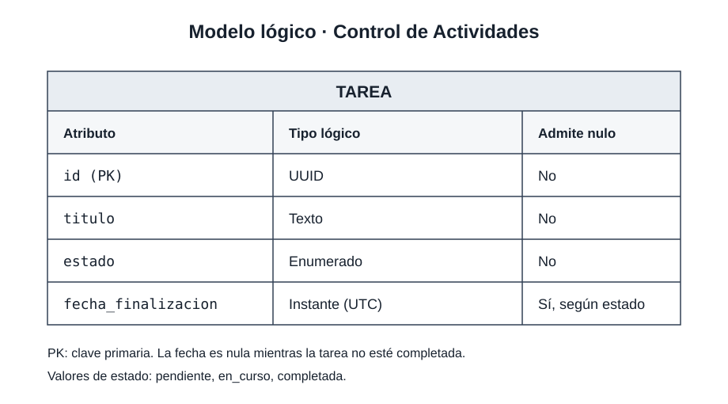

# Modelo de datos — Control de Actividades

Este documento define el modelo lógico mínimo para las [historias de usuario](../04-Casos%20de%20Uso/Historias-de-Usuario.md), a partir de los [requisitos funcionales](../02-Requisitos/Requisitos-Funcionales.md). El diseño utiliza localStorage desde el inicio del desarrollo. HU-01 implementa la lectura y validación; la creación y el guardado de cambios siguen pendientes.

## Entidad Tarea

Una **Tarea** representa un pendiente personal que puede pasar por los estados del tablero hasta completarse. Su identificador permite conservar la misma tarea al cambiarla de columna y reconocerla al repetir una operación.

| Atributo | Tipo lógico | Obligatorio | Descripción y reglas |
| --- | --- | --- | --- |
| `id` | UUID | Sí | Clave primaria. Identifica de forma única a la tarea y se conserva durante su existencia. |
| `titulo` | Texto | Sí | Nombre visible de la tarea. Debe contener al menos un carácter distinto de espacios y tratarse como texto al mostrarlo. El alcance vigente no contempla editarlo después de crear la tarea. |
| `estado` | Valor enumerado | Sí | Solo admite `pendiente`, `en_curso` o `completada`. Las tareas nuevas se crean con `pendiente`. |
| `fecha_finalizacion` | Instante con referencia temporal explícita | Solo al completar | Es nula en tareas pendientes o en curso. Al completar, guarda el momento de finalización y permanece inmutable. Se representa en UTC y se interpreta en America/Lima para las fechas y el conteo semanal. |

Cada tarea se representa como un objeto dentro de un arreglo JSON en localStorage. El identificador UUID, el título y el estado son cadenas; `fecha_finalizacion` es una cadena ISO 8601 en UTC o `null`. La lectura comprueba estos atributos, la unicidad de identificadores y el máximo de 10 tareas en curso, sin corregir ni sobrescribir datos inválidos.

## Diagrama del modelo



### Explicación del diagrama

El rectángulo representa la única entidad persistida del modelo: **Tarea**. Cada fila identifica uno de sus atributos. La marca **PK** señala el identificador único del modelo lógico y la columna de nulabilidad indica si el atributo puede carecer de valor. En localStorage, la validación de la aplicación deberá garantizar la unicidad del identificador.

El modelo tiene una sola entidad, por lo que no hay relaciones ni claves foráneas. El **Usuario** es el actor del sistema, sin una cuenta almacenada. Las columnas del tablero corresponden al atributo `estado`; el tablero se obtiene agrupando las tareas. La ocupación de En curso y el avance semanal son resultados calculados a partir de esas tareas.

## Estados y transiciones

| Valor de `estado` | Etiqueta en el tablero | Destinos permitidos | `fecha_finalizacion` |
| --- | --- | --- | --- |
| `pendiente` | Pendiente | En curso, si hay capacidad, o Completadas. | Nula. |
| `en_curso` | En curso | Pendiente o Completadas. | Nula. |
| `completada` | Completadas | Permanece completada; no puede reabrirse. | Obligatoria e inmutable. |

La creación y los movimientos están definidos en RF-02 y RF-03. Una tarea pertenece a una sola columna según su estado guardado.

## Reglas de integridad

- Cada tarea tiene un identificador único. Moverla conserva ese identificador y su título, sin generar otra tarea.
- Una tarea tiene fecha de finalización si y solo si está completada. El nuevo estado y la fecha se guardan juntos, como una sola operación consistente.
- Repetir la finalización de una tarea ya completada conserva su fecha original y no registra otra finalización.
- El conjunto de tareas con `estado = en_curso` admite un máximo de **10**. La regla se comprueba al guardar y debe mantenerse ante operaciones desde dos pestañas.
- Alcanzar el máximo permite seguir creando tareas pendientes y sacar tareas de En curso. Las **200 tareas totales** son el volumen de evaluación de rendimiento, sin constituir un límite de creación.
- Una escritura fallida se comunica como error y no se confirma como guardada. Los movimientos fallidos no deben perder ni duplicar tareas.

La aplicación deberá validar la colección al leer y guardar: identificadores únicos, títulos no vacíos, estados válidos y correspondencia entre estado completado y fecha de finalización. Los datos inválidos o una lectura fallida deben comunicarse como error, sin presentarlos como una colección vacía.

El límite sobre el conjunto de tareas, el cierre definitivo y la conservación de la fecha ante solicitudes repetidas deberán cumplirse en las operaciones del navegador. La coordinación de operaciones concurrentes y las escrituras en localStorage siguen pendientes de implementación y pruebas.

## Datos calculados

| Dato | Cálculo |
| --- | --- |
| Tareas de cada columna | Agrupar por `estado`. |
| Ocupación de En curso | Contar las tareas con `estado = en_curso` y mostrar el resultado junto al máximo de 10. |
| Avance semanal | Contar cada tarea completada una sola vez, utilizando `fecha_finalizacion` dentro del intervalo de la semana consultada. Si la consulta termina correctamente sin finalizaciones en ese periodo, el resultado es 0. |

La semana comienza el **lunes a las 00:00 en America/Lima (Perú)**, incluyendo ese instante, y termina al comenzar el lunes siguiente, sin incluir ese límite final. El intervalo mostrado y el conteo usan esa zona, independientemente de la configuración del dispositivo o del servidor, según [RF-06](../02-Requisitos/Requisitos-Funcionales.md#rf-06-consultar-el-avance-semanal).

Estos resultados se calculan desde las tareas guardadas; no requieren una entidad Semana ni un contador de finalizaciones persistido.

## Persistencia en localStorage

La clave `control-de-actividades:tareas` contiene un arreglo JSON con todas las tareas, incluidas las completadas. Una clave ausente y un arreglo vacío representan un tablero sin tareas. Un contenido vacío, JSON inválido o una colección inconsistente producen un error de lectura de datos, sin tratarlo como un tablero vacío.

Ejemplo del formato de almacenamiento; no se carga automáticamente en la aplicación:

```json
[
  {
    "id": "10000000-0000-4000-8000-000000000001",
    "titulo": "Preparar la revisión semanal",
    "estado": "pendiente",
    "fecha_finalizacion": null
  }
]
```

La consulta no escribe ni inicializa la clave. El guardado y los movimientos futuros conservarán este modelo; el avance semanal se calculará desde las fechas guardadas.

Los datos quedan asociados al mismo sitio y navegador. La recarga y la reapertura recuperan la información mientras se conserven sus datos locales, sin sincronización entre navegadores o dispositivos.

**No habrá respaldos ni restauración.** Si se borran los datos del sitio o del navegador, las tareas se pierden para la aplicación. Los errores de lectura y escritura mantienen las reglas de integridad de los [requisitos no funcionales](../02-Requisitos/Requisitos-No-Funcionales.md).

## Límites y estado

El modelo respeta el [alcance del MVP](../03-Alcance/Alcance-MVP.md) y sus [exclusiones](../03-Alcance/Fuera-de-Alcance.md). El acceso personal sin cuentas y la ausencia de adjuntos, subtareas y colaboración mantienen el modelo centrado en Tarea.

**Estado:** tipo Tarea, validación y lectura implementados en HU-01. El guardado, los movimientos y su coordinación entre pestañas siguen pendientes; la verificación de consulta se detalla en [HU-01](../04-Casos%20de%20Uso/HU-01.%20Consultar%20mi%20tablero.md#verificación-de-esta-entrega).
