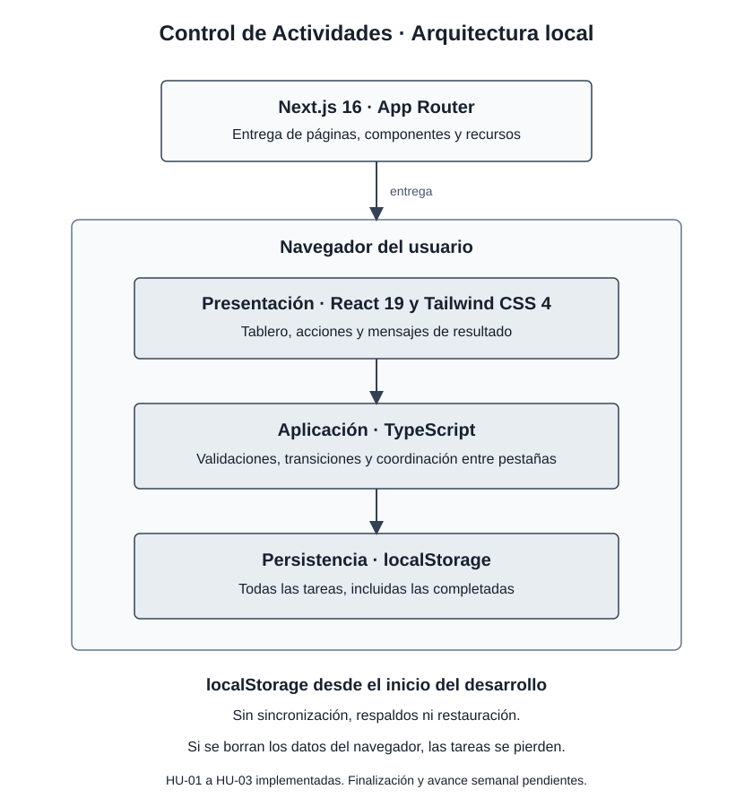

# Arquitectura general — Control de Actividades

La aplicación se organiza en tres capas lógicas: **presentación**, **aplicación y reglas**, y **persistencia**. Conserva una sola base de código con Next.js 16, React 19, TypeScript estricto y Tailwind CSS 4, y utiliza **localStorage desde el inicio del desarrollo**.

Este documento describe la arquitectura prevista para las [historias de usuario](../04-Casos%20de%20Uso/Historias-de-Usuario.md) y el [modelo de datos](../05-Datos/Modelo-de-Datos.md). HU-01 implementa la consulta del tablero y HU-02 el registro de pendientes en localStorage; los movimientos y el avance semanal siguen pendientes.

## Diagrama general

### Explicación del diagrama

Next.js entrega las páginas, componentes y recursos de la aplicación. Los componentes de cliente ejecutan las interacciones del tablero y acceden a localStorage cuando el navegador está disponible.

Las acciones sobre tareas se validan y coordinan en el navegador. La persistencia conserva todas las tareas, incluidas las completadas, dentro del mismo sitio y navegador. El servidor no accede a ese localStorage.

Las flechas representan las solicitudes desde la interfaz hacia la lógica y el almacenamiento. El resultado vuelve a la interfaz para mostrar las tareas o comunicar el éxito o fallo de una operación.

## Capas y responsabilidades

| Capa | Responsabilidad | Ubicación de ejecución |
| --- | --- | --- |
| Presentación | Mostrar columnas, títulos, ocupación de En curso y avance semanal. Recibir acciones y distinguir carga, vacío, éxito y error, con controles accesibles. | Componentes de React 19 y Tailwind CSS 4. Next.js compone la página y los componentes de cliente gestionan la interacción. |
| Aplicación y reglas | Validar títulos, coordinar creación y movimientos, respetar el máximo de 10 tareas en curso, mantener el cierre definitivo y calcular semanas en America/Lima. | TypeScript en el navegador, con lógica compartida y coordinación de operaciones desde dos pestañas. |
| Persistencia | Guardar y recuperar la colección de Tarea con identificador, título, estado y momento de finalización; validar los datos y comunicar fallos. | localStorage del mismo navegador y sitio desde el inicio del desarrollo. |

La organización prevista en archivos se detalla en [Estructura del proyecto](Estructura-del-Proyecto.md) y se materializará al implementar cada historia.

## Reglas en los límites de la arquitectura

- **Guardado consistente:** completar una tarea y registrar su fecha debe ser una sola operación. Repetir la finalización conserva la fecha original y no aumenta el conteo semanal.
- **Operaciones simultáneas:** HU-02 coordina lectura y escritura del registro mediante un bloqueo exclusivo de Web Locks llamado `control-de-actividades:tareas`. Requiere un contexto seguro y un navegador compatible; sin Web Locks no se guarda. Los futuros movimientos deberán compartirlo para respetar el máximo de 10 tareas en curso y el cierre definitivo, todavía pendientes de implementación.
- **Fechas:** el momento de finalización conserva una referencia temporal explícita. La clasificación semanal y las fechas mostradas utilizan America/Lima, con el inicio del lunes incluido y el comienzo del lunes siguiente excluido.
- **Acceso:** el usuario abre el tablero sin inicio de sesión. Cada navegador y sitio conserva sus propios datos. Las credenciales de los servicios conservados no son necesarias para el almacenamiento del tablero ni deben enviarse al navegador.
- **Errores de datos:** una lectura fallida se comunica como error. Una escritura fallida no se confirma como guardada y un movimiento no debe perder ni duplicar tareas.
- **Pérdida de datos locales:** no se implementan respaldos ni restauración. Si se borran los datos del sitio o del navegador, las tareas se pierden para la aplicación y no se recuperan desde otra copia.

Estas condiciones proceden de los [requisitos funcionales](../02-Requisitos/Requisitos-Funcionales.md) y los [requisitos no funcionales](../02-Requisitos/Requisitos-No-Funcionales.md). Su descripción no acredita que los controles estén implementados.

## Tecnologías conservadas y despliegue

**Vercel** es el destino previsto de despliegue de Next.js; su configuración y el despliegue no están verificados. Si la aplicación se publica en internet, sus comunicaciones deberán utilizar HTTPS.

La configuración de **Amazon S3 privado** se conserva. El alcance vigente excluye archivos adjuntos, por lo que S3 no participa en la persistencia de las tareas.

La conservación de los datos depende del navegador. Esta decisión no fija un porcentaje de disponibilidad del sitio ni incorpora un modo sin conexión completo.

## Estado actual

| Elemento | Estado comprobado en el repositorio |
| --- | --- |
| Base de Next.js | Página del tablero, layout en español, estilos y comandos de desarrollo, lint, tipos y compilación definidos. |
| Consulta del tablero y localStorage | Lectura y validación implementadas en HU-01, con carga, vacío, error, columnas, títulos y ocupación de En curso. |
| Registro de pendientes | Formulario, validación y guardado de HU-02 con Web Locks; conserva la colección vigente y solo confirma después de escribir. |
| Demás funciones | Movimientos, su coordinación entre pestañas y avance semanal pendientes de implementación. |
| Modelo de datos | Documenta la colección local y sus reglas de validación e integridad. |
| S3 y Vercel | Configuración conservada de S3 y destino previsto de despliegue, sin integración funcional de archivos ni despliegue verificado. |

Las comprobaciones de consulta están en [HU-01](../04-Casos%20de%20Uso/HU-01.%20Consultar%20mi%20tablero.md#verificación-de-esta-entrega), y las de registro, coordinación y sus límites en [HU-02](../04-Casos%20de%20Uso/HU-02.%20Registrar%20un%20pendiente.md#verificación-en-navegador-y-pendientes). La contención simultánea controlada entre pestañas reales sigue pendiente de verificar.

## Referencias

- [Flujos de una tarea, paso a paso](Flujos.md).
- [Modelo de datos](../05-Datos/Modelo-de-Datos.md).
- [Historias de usuario y diagrama de casos de uso](../04-Casos%20de%20Uso/Historias-de-Usuario.md).
- [Alcance del MVP](../03-Alcance/Alcance-MVP.md).
- [Fuera de alcance](../03-Alcance/Fuera-de-Alcance.md).
- [Preparación y comandos del proyecto](../../README.md).
